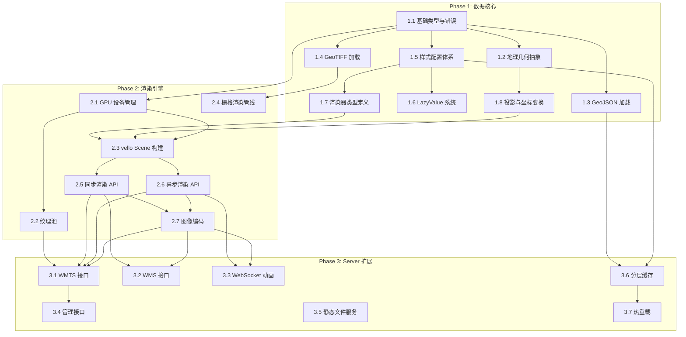

# Geello — 编码路线图

> 按需求依赖关系排列，Phase 顺序即为推荐实现顺序。

---

## Phase 1: 数据核心 (`src/core`)

> 无外部模块依赖，是所有后续 Phase 的基础。

### 1.1 基础类型与错误系统

| 编号 | 任务 | 对应需求 | 状态 |
|------|------|----------|------|
| 1.1.1 | 定义 `GeelloError` 枚举（14 种错误变体） | REQ-800a | ✓ |
| 1.1.2 | 定义 `GeelloResult<T>` 类型别名 | REQ-800b | ✓ |
| 1.1.3 | 实现 `std::error::Error` + `Display` + `thiserror` derive | REQ-800 | ✓ |
| 1.1.4 | 为外部依赖错误实现 `From<T> for GeelloError` | — | ✓ |

> 注：foyer 缓存系统已提升为核心依赖，`LayerCache` + `LayerCacheBuilder` 定义于 `src/core/cache.rs`。

### 1.2 地理几何抽象

| 编号 | 任务 | 对应需求 | 状态 |
|------|------|----------|------|
| 1.2.1 | 定义 `RenderedGeometry` / `RenderedLayer` / `LayerSource` / `WorkspaceRegistry` / `PropertyValue` | REQ-100, REQ-102 | ✓ |
| 1.2.2 | 定义 `LayerId` 标识类型 (workspace + name) | REQ-203b, REQ-102a | ✓ |

> 注：包围盒计算使用 `geo::algorithm::BoundingRect`，视口裁剪逻辑合并至 2.3。

### 1.3 GeoJSON 加载

| 编号 | 任务 | 对应需求 | 状态 |
|------|------|----------|------|
| 1.3.1 | 本地文件加载 `.geojson` / `.json` | REQ-100a | ✓ |
| 1.3.2 | Feature / FeatureCollection / Geometry 三种根类型解析 | REQ-100c | ✓ |
| 1.3.3 | 多图层 `,` 分隔加载，按顺序存储 | REQ-100d | ✓ |
| 1.3.4 | HTTP URL 加载（feature: `from_http`） | REQ-100b | ✓ |

### 1.4 GeoTIFF 加载（feature: `raster`）

| 编号 | 任务 | 对应需求 | 状态 |
|------|------|----------|------|
| 1.4.1 | 本地 `.tif` / `.tiff` 文件解码 | REQ-101a |
| 1.4.2 | 多波段 RGB 合成 | REQ-101b |
| 1.4.3 | 单波段灰度渲染 | REQ-101c |
| 1.4.4 | 8-bit 和 16-bit 像素格式支持 | REQ-101d |
| 1.4.5 | GeoTransform + CRS 信息提取（`tiff` crate tags） | REQ-304 |

### 1.5 样式配置体系

| 编号 | 任务 | 对应需求 | 状态 |
|------|------|----------|------|
| 1.5.1 | 定义 `Style` / `LayerStyle` / `RendererDef` 容器结构 | REQ-200 | ✓ |
| 1.5.2 | 定义 `RenderRegion` 枚举（全量/矩形/瓦片/缓冲区） | REQ-200a | — |
| 1.5.3 | 定义 `PixelOption`（宽/高/背景色） | REQ-200b | — |
| 1.5.4 | 定义 `TileProj` 枚举（EPSG:4326 / EPSG:3857） | REQ-200c | — |

> 注：1.5.1 重新设计为三层结构 `Style → LayerStyle → RendererDef`，
> 文件位于 `src/core/style/`。1.5.2–1.5.4 将在后续渲染阶段按需定义。

### 1.6 LazyValue 延迟解析系统

| 编号 | 任务 | 对应需求 | 状态 |
|------|------|----------|------|
| 1.6.1 | 定义 `LazyValue<T>` 泛型枚举（6 种变体） | REQ-201 | ✓ |
| 1.6.2 | `Inline(T)` 变体实现 | REQ-201a | ✓ |
| 1.6.3 | `File(path)` 从 TOML/JSON 文件加载 | REQ-201b | ✓ |
| 1.6.4 | `Toml(content)` 从内联字符串解析 | REQ-201c | ✓ |
| 1.6.5 | `Prop(field, encoding)` 从 GeoJSON properties 读取 | REQ-201d | ✓ |
| 1.6.6 | `JsonFile(path)` 从 JSON 文件加载 | REQ-201e | ✓ |
| 1.6.7 | `Url(url, encoding)` 从 HTTP 加载（feature: `from_http`） | REQ-201f | ✓ |
| 1.6.8 | 实现 `LazyValue::resolve()` / `resolve_static()` | — | ✓ |

### 1.7 渲染器类型定义

| 编号 | 任务 | 对应需求 | 状态 |
|------|------|----------|------|
| 1.7.1 | 定义 `RendererDef` / `RendererKind` / config 占位类型 | REQ-202 | ✓ |
| 1.7.2 | `PointConfig` 配置（半径/颜色/fill） + resolve | REQ-202a | ✓ |
| 1.7.3 | `LineConfig` 配置（线宽/join/cap/颜色） + resolve | REQ-202b | ✓ |
| 1.7.4 | `AreaConfig` 配置（填充色/边界线） + resolve | REQ-202c | ✓ |
| 1.7.5 | `TextConfig` 配置（字体/字号/颜色/锚点） + resolve | REQ-202d | ✓ |
| 1.7.6 | `RasterConfig` 配置（feature: `raster`） + resolve | REQ-202e | ✓ |
| 1.7.7 | `GeometryFilter`（属性筛选 + bbox 筛选） | REQ-203 | ✓ |

### 1.8 投影与坐标变换

| 编号 | 任务 | 对应需求 | 状态 |
|------|------|----------|------|
| 1.8.1 | 任意 EPSG → EPSG:4326 / EPSG:3857 投影变换 | REQ-304a | ✓ |
| 1.8.2 | 同上 — 统一 `transform_layer` 入口 | REQ-304a | ✓ |
| 1.8.3 | WMTS 瓦片索引 (x, y, z) → 地理矩形坐标 | REQ-304b | ✓ |
| 1.8.4 | 世界坐标 → 像素坐标映射（affine transform） | — | ✓ |

---

## Phase 2: 渲染引擎 (`src/render`)

> 依赖 Phase 1 的数据结构，不依赖 Server。

### 2.1 GPU 设备管理

| 编号 | 任务 | 对应需求 | 状态 |
|------|------|----------|------|
| 2.1.1 | wgpu 设备自动检测与初始化 | REQ-700a | ✓ |
| 2.1.2 | 多 GPU 接口预留（当前仅使用第一个适配器） | REQ-700b | ✓ |
| 2.1.3 | `RenderContext` 结构体（持有 Device/Queue/Renderer） | REQ-300 | ✓ |

### 2.2 纹理池（Server 模式前置）

| 编号 | 任务 | 对应需求 | 状态 |
|------|------|----------|------|
| 2.2.1 | `TexturePool` 结构体（预分配可复用 Texture） | REQ-701a | ✓ |
| 2.2.2 | Semaphore 限流并发请求 | REQ-701b | ✓ |
| 2.2.3 | `acquire()` / `release()` 接口 | REQ-701c | ✓ |

### 2.3 vello Scene 构建

| 编号 | 任务 | 对应需求 | 状态 |
|------|------|----------|------|
| 2.3.1 | 几何 → `vello::kurbo::BezPath` 转换（核心算法） | REQ-300a | ✓ |
| 2.3.2 | Point → Circle BezPath（fill 模式） | REQ-202a | ✓ |
| 2.3.3 | LineString/MultiLineString → stroke BezPath | REQ-202b | ✓ |
| 2.3.4 | Polygon/MultiPolygon → fill BezPath + 可选 stroke 边界 | REQ-202c | ✓ |
| 2.3.5 | Point → Text glyph（skrifa 排版 → vello glyph） | REQ-202d |
| 2.3.6 | 栅格数据 → vello image push | REQ-202e |
| 2.3.7 | 按 `GeometryFilter` 筛选图层 | REQ-203 |
| 2.3.8 | 构建完整 `vello::Scene`（按渲染器顺序分层） | REQ-300a |
| 2.3.9 | 视口裁剪：`geo::BoundingRect` 计算 bbox，视口外几何剔除 | — |

### 2.4 栅格渲染管线（feature: `raster`）

| 编号 | 任务 | 对应需求 | 状态 |
|------|------|----------|------|
| 2.4.1 | tiff 像素数据 → `image` crate 缩放/色彩处理 | REQ-101 |
| 2.4.2 | 像素数据 → `wgpu::Texture` 上传 | — |
| 2.4.3 | 纹理 quad 绘制（全屏两个三角形） | — |
| 2.4.4 | 栅格纹理坐标 ↔ 地理坐标映射 | — |

### 2.5 同步渲染 API

| 编号 | 任务 | 对应需求 | 状态 |
|------|------|----------|------|
| 2.5.1 | `render_to_texture()` — 渲染到已有纹理 | REQ-301a |
| 2.5.2 | `render_to_buffer()` — 渲染到 CPU 缓冲区 | REQ-301b |
| 2.5.3 | `render_to_buffer_with_new_texture()` — 创建新纹理并渲染 | REQ-301c |
| 2.5.4 | wgpu Texture → CPU `Vec<u8>` RGBA 回读（`block_on_wgpu`） | REQ-300c |

### 2.6 异步渲染 API

| 编号 | 任务 | 对应需求 | 状态 |
|------|------|----------|------|
| 2.6.1 | `render_to_buffer_async()` — `spawn_blocking` 包装 | REQ-302a |
| 2.6.2 | `render_to_buffer_with_new_texture_async()` | REQ-302b |

### 2.7 图像编码

| 编号 | 任务 | 对应需求 | 状态 |
|------|------|----------|------|
| 2.7.1 | PNG 编码（`image` crate） | REQ-303a |
| 2.7.2 | JPEG 编码 | REQ-303b |
| 2.7.3 | WebP 编码接口预留 | REQ-303c |
| 2.7.4 | Content-Type 与格式映射工具函数 | — |

---

## Phase 3: Server 扩展 (`src/server`)

> 依赖 Phase 1 + Phase 2。

### 3.1 WMTS 接口

| 编号 | 任务 | 对应需求 | 状态 |
|------|------|----------|------|
| 3.1.1 | `GET /wmts/real-time` — 实时渲染瓦片 | REQ-400a |
| 3.1.2 | `GET /wmts/cache` — 带磁盘缓存瓦片 | REQ-400b |
| 3.1.3 | 查询参数解析（`layers` / `styles` / `x` / `y` / `z` / `format`） | REQ-400c |
| 3.1.4 | 瓦片索引 → 地理范围 → 渲染参数转换 | REQ-304b |
| 3.1.5 | 错误 → HTTP 状态码映射 | REQ-800c |

### 3.2 WMS 接口

| 编号 | 任务 | 对应需求 | 状态 |
|------|------|----------|------|
| 3.2.1 | `GET /wms` — 按 bbox 渲染 | REQ-401a |
| 3.2.2 | bbox 参数解析（`minx,miny,maxx,maxy`） | REQ-401b |
| 3.2.3 | `width` / `height` 参数确定画布尺寸 | — |

### 3.3 WebSocket 动画

| 编号 | 任务 | 对应需求 | 状态 |
|------|------|----------|------|
| 3.3.1 | `WS /ws/anim` — 实时动画帧推送 | REQ-402a |
| 3.3.2 | 帧间隔控制与定时推送 | — |

### 3.4 管理接口

| 编号 | 任务 | 对应需求 | 状态 |
|------|------|----------|------|
| 3.4.1 | `GET /health` — 200 OK | REQ-403a |
| 3.4.2 | `GET /cache/stats` — 缓存统计 JSON | REQ-403b |
| 3.4.3 | `GET /example/{name}` — 渲染器配置示例 TOML | REQ-403c |

### 3.5 静态文件服务

| 编号 | 任务 | 对应需求 | 状态 |
|------|------|----------|------|
| 3.5.1 | `GET /map/{*path}` — Leaflet 前端示例 | REQ-404a |

### 3.6 分层缓存系统

| 编号 | 任务 | 对应需求 | 状态 |
|------|------|----------|------|
| 3.6.1 | Layer 缓存 — 解析后 GeoJSON 内存缓存 | REQ-500a |
| 3.6.2 | Style 缓存 — 解析后 TOML 样式内存缓存 | REQ-500b |
| 3.6.3 | Tile 缓存 — 渲染后瓦片（内存 + 磁盘混合，`foyer` crate） | REQ-500c |
| 3.6.4 | TTL 过期策略 | REQ-501a |
| 3.6.5 | 文件 mtime 失效检测 | REQ-501b |
| 3.6.6 | 手动失效 API（`remove_layer` / `remove_style`） | REQ-502a |

### 3.7 热重载

| 编号 | 任务 | 对应需求 | 状态 |
|------|------|----------|------|
| 3.7.1 | `notify` crate 监听数据目录文件变更 | REQ-601a |
| 3.7.2 | `.toml` 变更 → 样式缓存失效 | REQ-601b |
| 3.7.3 | `.geojson` / `.json` / `.tif` 变更 → 数据缓存失效 | REQ-601c |
| 3.7.4 | 文件变更自动失效（热重载） | REQ-502b |

---

## 依赖关系图

---

## Feature Gate 映射

| Feature     | 涉及模块 | 依赖 Tasks |
|-------------|----------|-----------|
| `default`   | core + render（全部同步 API） | Phase 1 + Phase 2 |
| `server`    | core + render + server | Phase 1 + 2 + 3，需额外依赖 axum/figment/image/tracing-subscriber |
| `from_http` | core（LayerSource::Http + LayerCache HTTP client + LazyValue::Url） | 1.3.4, 1.6.7 |
| `from_samba` | core（LayerSource::Samba） | (预留) |
| `raster`    | core + render（GeoTIFF + 栅格管线） | 1.4, 2.4 |

---

## 当前状态

| Phase | 完成度 | 备注 |
|-------|--------|------|
| Phase 1 | ~58% | 1.1–1.3 + 1.5–1.8 已完成 |
| Phase 2 | ~27% | 2.1–2.3.4 已完成 |
| Phase 3 | ~15% | config + state + stub route 已实现 |

### 已有代码清单

- `src/core/error.rs` — `GeelloError` + `GeelloResult` (REQ-800 ✓)
- `src/core/layer.rs` — `LayerId`, `LayerSource`, `Crs`, `ProjectionSpec`, `WorkspaceRegistry`, `RenderedGeometry`, `RenderedLayer`, `load_layers` / `load_layer` (REQ-100, REQ-102 ✓)
- `src/core/geojson.rs` — GeoJSON 解析 + CRS 自动检测 (REQ-100 ✓)
- `src/core/cache.rs` — `LayerCache` / `LayerCacheBuilder`, foyer 内存缓存 + HTTP 加载 (REQ-100b, REQ-500a ✓)
- `src/core/style/` — `Style` / `LayerStyle` / `LayerFilter` / `RendererDef` / `GeometryFilter` 容器 (REQ-200, REQ-203 ✓)
- `src/server/config.rs` — `ServerConfig` + figment 多层配置 (REQ-600 ✓)
- `src/server/state.rs` — `AppState` 定义
- `src/server/mod.rs` — Axum 应用启动流程
- `src/server/routes/wmts.rs` — `/wmts/cache` stub
- `Dockerfile` — 多阶段 musl 构建 (REQ-1000 ✓)
- `Cargo.toml` — 全部依赖声明 + feature flags (REQ-900 ✓)
