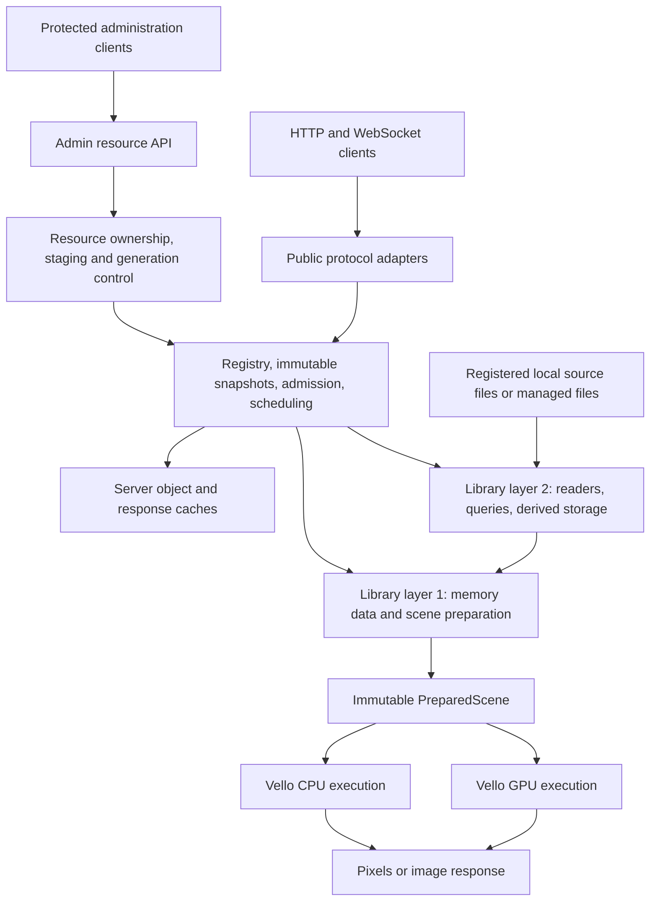
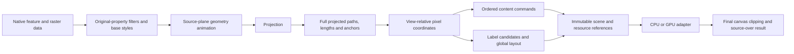

# Architecture and data flow

This is the Accepted target architecture. M1–M3 and the memory-only M4
animation subset are implemented on `refactor`; text, geometry trajectories and
public protocol surfaces remain staged work. See [requirements](02-requirements-and-acceptance.md) for acceptance IDs and [interfaces](04-public-apis-and-configuration.md) for target contracts.

The [M3 implementation checkpoint](09-m3-service-and-evidence.md) records the
current derived formats, resource publication/retention, lazy preparation,
queues/caches and basic service behavior separately from this target baseline.

## 1. Ownership and dependency direction



The arrows express use/flow, not a requirement that the library call the server. The library is independently useful. There is one crate, with conceptual modules rather than a forced workspace split:

| Owner | Owns | Must not own |
| --- | --- | --- |
| Layer 1: in-memory processing | Typed features, native raster blocks, CRS/view math, projection operations, typed styles/animation, text shaping/layout, scene preparation, backend execution | Paths, file decoding, server resource IDs/registry, server cache, HTTP/WS, mandatory Tokio runtime |
| Layer 2: readers and composition | Source handles, immutable reader snapshots, metadata/schema, batched vector queries, native raster windows, indexes and derived storage, read/prepare convenience APIs | Protocol parsing, global server publication registry, response caches, socket scheduling |
| Server | TOML resource graph loading, configured source registration, publication/version orchestration, HTTP/WS adapters, budgets/admission, scheduling, caches, encoding responses, diagnostics | Duplicate projection/style/layout logic, mutable source geometry for playback, direct file decoding inside handlers |

Layer 2 implements storage mechanisms; the server decides when to prepare, publish, retain, and retire versions. A caller can use readers and prepared scenes without running Axum. Image encoding is an optional library utility and a server requirement, not a responsibility of a rendering backend.

The administration plane is separate from the public data plane. `/admin/v1` accepts resource mutations only behind deployment-level access control. Public OGC, legacy protocol and WebSocket routes resolve published resource IDs through the current catalog generation; they never accept request paths to files. The first-stage server has no user/tenant authorization model, so the reverse proxy is responsible for protecting administrative access.

Resource ownership is explicit. A managed resource has bytes in Geello's managed directory and can later have its content deleted. An external resource stores a validated local path and interpretation metadata but does not transfer ownership; its file cannot be deleted through the API. `unpublish` stops new discovery/use while retaining the record and bytes. Record removal removes the registration but does not remove bytes. Content deletion is a separate operation and is refused for external resources. Cascading unpublish/delete is not performed.

All mutations use a current resource version/ETag. A stale mutation returns a conflict without changing the current generation. A successful upload or replacement streams into staging, validates archive safety and format/resource references, performs the required bounded preparation, then writes an immutable resource version and atomically switches the catalog generation. A failure leaves the prior complete generation serving. The operation record reports `staging`, `preparing`, `ready`, `failed`, or `unpublished` with bounded diagnostics.

Configuration loading is preparation-time IO. Layer 1 receives already resolved typed resources and font bytes. There is no generic lazy value that can read a path or URL during evaluation.

## 2. Core data contracts

### Features and identity

A feature contains an effective typed identity, original identity/provenance, source ordinal, typed property tree, nullable geometry state, XY geometry, and structurally aligned optional source ordinates. Property values preserve Null, Bool, String, I64, U64, F64, Array and Object. Missing is a lookup result, not a fabricated Null property. Spatial operations use `geo-types<f64>` XY.

Z/M are preserved as source information, not transformed vertically. Unknown GeoJSON coordinates after Z must not be guessed to be M. New vertices or arbitrary geometry results cannot acquire invented Z/M values; keep original provenance separate and mark unavailable transformed ordinates honestly.

Effective IDs are strings or integers covering i64/u64. String `"42"` differs from numeric `42`; positive signed/unsigned representations denote one numeric identity. A noninteger original ID remains provenance but cannot serve as the effective numeric ID. The source uses a configured unique attribute or version-local generated identity when needed. Stable cross-refresh geometry animation requires an explicitly stable identity policy.

Strict preparation rejects duplicate effective IDs. An explicitly tolerant source keeps the first source ordinal and reports skipped duplicates. Null and legal empty geometry remain distinct records in ordinary/ID queries and statistics but do not draw.

Public feature identifiers encode the effective typed identity reversibly: positive integer 42 as `f_n_p42`, negative integer -42 as `f_n_m42`, string `"42"` as UTF-8 hex `f_s_3432`. Zero uses the positive numeric form. Generated IDs use a separate marker plus DataVersion and source ordinal. Do not use display strings to compare typed identity.

### Raster data

A RasterBlock is native numeric bands plus dimensions, grid/affine metadata, validity information, source alpha association and provenance. Memory bands may have different numeric types but share dimensions/grid. Support owned/shared contiguous data and borrowed views; arbitrary strides and external storage are outside this contract.

The six-coefficient affine transform includes rotation/shear. Origin refers to pixel edge `(0,0)` and sample center `(0.5,0.5)`, with PixelIsArea/PixelIsPoint interpretation retained. Missing/inconsistent tags, noninvertibility, contradictory tiepoints and unsupported GCP/RPC-only positioning fail rather than being silently fitted. CRS override does not imply a georeferencing override feature.

Raw numeric reads preserve types and raw nonfinite samples. Processing/statistics treat NaN/Infinity as invalid with counters. Raw nearest sampling can preserve i64/u64 exactly; interpolation/calibration/display may use f64 and must document rounding above 2^53.

## 3. Reading and query flow

1. Open a source with explicit interpretation options and immutable version identity.
2. Validate metadata, identity policy, declared queryables and schema. Build/check the required index or derived representation under budget.
3. Create an independent sequential cursor for each query on the shared snapshot.
4. Yield owned/shared batches bounded by record count and bytes. Batches can outlive the next read; all retained allocations count toward live usage.
5. Stop at EOF, a terminal error, cancellation or deadline. Never report an error as EOF.

Do not split a feature across batches. A single feature exceeding its hard limit is an explicit error. Bounds include JSON depth, coordinate/property scale, decoder scratch space and IFD/tag allocations, not just yielded output. A compressed strip may require much more than the requested raster window; reject before unbounded decode or report the actual bound.

Cancellation is runtime-independent and cooperative at IO, batch, CPU/raster, and GPU boundaries. It does not promise to interrupt an OS syscall, third-party decode, or submitted GPU command. Library budget exhaustion returns promptly; only the server may queue work, and that queue is bounded.

GeoJSON parsing must identify the root type/member structure. The crate's deprecated first-`[` streaming shortcut is unsuitable when root bbox/extensions precede `features`. Use a proper serde_json-based root-aware bounded reader, with the approved geojson types/conversions where useful. Structural corruption terminates the stream. Tolerant mode only skips a record whose boundary is reliably known.

Shapefile decoding covers supported point/multipoint/polyline/polygon XY/Z/M and NullShape. MultiPatch is unsupported. DBF encoding precedence is explicit override, then reliable `.cpg`/supported marker, otherwise require configuration; no guessed encoding or replacement characters.

Rendering can request bbox candidates with conservative symbol expansion. Feature spatial queries must perform exact geometric intersection and return complete original geometry. A declared queryable is a top-level scalar property with an explicit public alias and type. Equality filters are ANDed with bbox and ID selection; multiple IDs are ORed. No string trimming/case folding or implicit numeric/string/bool coercion is allowed.

Pagination uses source order, not physical index order. Return exact `numberReturned`; total count can be unknown. Exact hits must finish within budget. Buffer/validate a whole page before sending 200 so a late budget error cannot produce a broken successful stream.

## 4. Scene preparation and rendering flow



For rasters, native window reads feed inverse projection/resampling/validity/calibration/color processing on bounded CPU workers, then prepared image commands. The backend composites those pixels; it does not interpret GeoTIFF tags or resample numeric bands.

### Ordering and geometric semantics

Map item order, matching rule order, symbol order, feature source ordinal and geometry component order are explicit. Rendering is **symbol-major over all batches/features**: draw all casings before all interiors. Parallel preparation must merge results deterministically; a streaming implementation cannot make batch size alter the image. Bounded sorting/spooling or a replay strategy must preserve this contract, otherwise fail the budget instead of reordering.

Point symbols use compatible point components or complete projected line/polygon anchors. Line symbols use line components and configured polygon rings. Area symbols use polygon components only. Collections recurse without joining separate components. Zero-length lines generate no stroke; an independently applicable point symbol can still draw. A polygon uses even-odd filling per polygon, explicit exterior/interior/all ring stroke selection, and no automatic topology repair.

Project original vertices without automatic densification. Compute line distance, dash phase, line midpoint, polygon interior/largest-component anchors and label repeat positions on the full projected geometry. Do not change them after viewport clipping. Full path plus final canvas clip is the correctness baseline; any optimization must preserve caps, joins, dash origin and absence of artificial polygon cut-edge outlines.

Rebase world coordinates relative to the view before f32 backend conversion. Library aspect-fit letterboxes by default; service bbox requests use the defined stretch. Scalar map-unit lengths under anisotropic stretch use `sqrt(sx * sy)` so markers/glyphs preserve aspect. Nominal scale uses its inverse with 0.28mm pixels, without local ground-distance correction.

For static candidate selection, compute a reliable maximum symbol/label extent from configuration and prepared data statistics. If no reliable extent exists, scan fully or return a budget error. A user-specified bound that is exceeded is an error, not permission to omit geometry.

Wrapped geographic query bounds can split/deduplicate. Geometry edges are not implicitly shortened across the antimeridian; no repeated worlds or modulo tile indexing. Transform viewport bounds using the accepted corner-only policy and publish only tested CRS/domain combinations where that policy is correct. Known target-domain clipping is transparent; actual transformation errors remain strict errors. Do not advertise arbitrary nonlinear-envelope correctness.

### Scene product and backend contract

PreparedScene is opaque, immutable and backend-independent. Its public summary exposes dimensions, versions, drawing/label statistics, accounting and diagnostics; its command encoding is private. It retains actual drawing geometry, colored raster pixels and required font references. It releases readers/source snapshots and holds no lazy source blocks.

Reusing a scene means reusing the same view/time/resource result; changed inputs require preparation. Scenes exceeding a limit fail as a whole in phase 1; there is no segmented backend execution fallback.

CPU preparation/execution is synchronous. GPU creation, completion and readback are async without requiring Tokio in the library. GPU contexts can be library-created or accept a compatible same-version wgpu Device/Queue. The GPU contract validates entire target size, format, usage and device relationship.

External targets are single-sample, same-size `RGBA8Unorm`, full replacement, premultiplied content. There is no load-existing, BGRA, swapchain or multisample promise. A failure before submission leaves the external target unchanged. After submission a failure/cancellation cannot roll back; content is considered invalid. A CPU renderer cannot satisfy a GPU-texture request.

Both pixel APIs return tightly packed top-left straight RGBA8 with sRGB RGB bytes; zero alpha has zero RGB. Composite only normal source-over. Color alpha times symbol opacity applies per feature/fill/stroke, not as group opacity. JPEG flattens against an explicit background once after the entire map is composed.

Check dimensions with overflow-safe arithmetic against u16 Vello limits, device constraints and budget, including metatile buffer. CPU/GPU use the same geometry, order and label placement, with tolerances for rasterization differences. Server default is GPU-preferred with CPU fallback only on initialization failure; actual backend is visible and keyed in caches. Runtime GPU faults return errors until explicit reinitialization/restart.

## 5. Numeric raster processing and overviews

Separate APIs expose raw source windows, reprojection, resampling, calibration and color mapping. NoData comparison occurs on raw per-band values before scale/offset. Memory masks/validity are distinct from alpha. Invalid selected RGB bands invalidate the selected color; an invalid unselected band does not.

Choose category/continuous semantics from reliable metadata or explicit configuration, never from integer type alone. Categories use nearest. Continuous enlargement uses bilinear; downsampling uses area averages. Reject invalid combinations. Normalize over valid contributing weights; all-invalid/outside output is transparent. Partial valid coverage does not independently reduce alpha. Interpolate source color with the declared alpha association and premultiply exactly once; alpha-zero hidden RGB must not be reconstructed.

Basic display is explicit gray/RGB/RGBA channel mapping, ranges and opacity, without ramps, gamma, classes or ICC conversion. Use explicit or DataVersion-wide valid min/max, never per-tile min/max; u8 color channels use 0..255. Constant automatic range uses midpoint brightness plus a diagnostic. All-invalid data publishes empty statistics and renders transparently, rather than failing solely for being empty.

GeoTIFF numeric uniform file layouts cover i/u8/16/32/64, f32/f64 and lossless f16 promotion to f32 with source bit depth retained. Mixed file sample layouts, unsupported photometry and complex/packed samples are excluded. Internal validity masks unsupported by the approved decoder cause explicit rejection. WhiteIsZero raw recovery, associated alpha and overview traversal require evidence before support claims. Multiple primary images require explicit IFD selection unless uniquely/unambiguously identifiable; overviews/thumbnails/masks are not silently stacked as bands or published as independent primaries.

Publish base metadata/basic access/global statistics first, then build overviews in bounded background work. A complete overview set publishes a new DerivedVersion atomically. A source overview is usable only after checking grid, bands, validity and generation/resampling semantics. Unvalidated overviews can be bypassed for base data; masks cannot be ignored.

Keep nearest and weighted mean generations distinct. Store effective weights/counts so multilevel reduction does not become mean-of-means. f64 generated levels can round and need not match every arbitrary direct-base resize bit-for-bit. Select a deterministic conservative level no coarser than target sampling, accounting conservatively for rotation/anisotropy; use finer/base data if necessary. Load must not change quality or sampling policy.

## 6. Text and animation

### Text resources and layout

Use cosmic-text shaping/bidi/fallback with explicit versioned font bytes and face index. Each stack has isolated fallback; unrelated registered fonts cannot satisfy it. Normal/bold/italic are exact resources, without synthesis or family-name approximation. Do not scan system fonts. Language defaults to `und`, with explicit map/symbol BCP47 overrides rather than OS locale.

Support uniform plain horizontal text, CJK, bidi and curved lines; no rich text, color emoji or vertical layout in phase 1. Text comes from a literal string or string property, with no implicit numeric conversion. Wrap via Unicode line breaks then grapheme boundaries for long words; never split clusters, shrink or ellipsize implicitly. Curved text is single-line: wrap width is invalid and evaluated newline causes error or an explicitly tolerant skip.

Draw all map content first, collect marker obstacles, then run one global label pass. Higher priority wins; equal priority favors later-drawn content, then stable ordinals. Collision selection and final label draw order are separate. Recompute deterministically per frame; temporal flicker is permitted.

Point defaults try NE, E, SE, N, S, NW, W, SW, 2px from its visible marker or anchor. Its own current-item feature marker is not an obstacle, but other markers are. Polygon label plus halo box must fit within the true polygon excluding holes. Multiple compatible components receive candidates unless explicitly limited to one. Overlap must be explicitly allowed.

Curved labels stay on each source component without same-name merging: first at 150px, then every 300px, with midpoint fallback for a short line that can fit the label. Use full projected path distance before crop. Keep clusters upright, maximum neighboring-cluster bend 30 degrees and total angular span 90 degrees; omit insufficient/curvy placements.

Tiles default to fixed aligned 4x4 metatiles plus 128px buffer, configurable. Labels are shared inside that area; exact agreement across distinct metatiles is not promised. No world wrapping.

Test fixtures use committed, renamed subsets from approved Noto versions with shaping closures and license/source/hash records. FontTools is maintenance tooling only. Application fonts are separately configured; test fonts are not silent production defaults.

### Animation evaluation

Evaluate base styles/filters from original properties, then source-plane geometry animation before projection. Whole-feature ordered translate/rotate/scale and trajectory positioning are supported; no vertex morph or source-history interpolation. Geometry tracks target stable effective IDs, read independently of viewport, and obey feature/byte limits. Source feature queries never see animated coordinates.

Trajectories interpolate in the source CRS plane, by length or explicit timestamps as configured; no geodesic promise. Position the configured anchor at the trajectory point, then apply ordered transforms. An anchor follows earlier transforms. Repeated transforms are legal; multiple tracks writing the same target parameter are conflicts.

Tracks use strictly increasing times, step or linear interpolation, finite values and fixed compatible units. Rotation interpolates raw numeric angles, so 350 to 10 means -340 degrees and 350 to 370 means +20 degrees. Style tracks replace selected size/angle/width/fill/stroke color/opacity values. Text layout remains static and rasters only animate opacity.

Colors interpolate after sRGB-to-linear conversion and alpha premultiplication, then unpremultiply and convert back; alpha-zero RGB is zero. Independent symbol opacity multiplies afterward. Time is nonnegative finite seconds, with positive speed. Binding start/speed/once-or-loop belong to map bindings, not duplicated inside actions. Before start use base state; once-ended holds final state; loop wraps local time. Map time itself continues.

Resource refresh preserves the connection clock, rebinds stable IDs and recomputes anchors; missing IDs are skipped with diagnostics and incompatible coordinate interpretation rejects the item update. A paused connection redraws on successful resource change.

## 7. Resource catalog, derived storage and versions

### Resource files, catalog generations and administration

Resource definitions retain TOML readability without making directory enumeration part of request processing. The selected layout is independent immutable resource versions plus type/namespace-sharded indexes and an atomic generation pointer:

```text
data/
  managed/                         # uploaded bytes and immutable versions
  external/                        # registration records and metadata only
  registry/
    catalog.toml                   # schema, current generation, shard list
    shards/                        # bounded resource lookup shards
    generations/                   # copy-on-write complete generation manifests
  staging/                         # bounded in-progress uploads
  operations/                      # upload/validation/preparation state
  derived/                         # FGB/raster derived versions
```

The exact directory names are configuration values, but the ownership and atomicity rules are fixed. A request loads the current catalog generation and performs an indexed lookup; it never recursively scans all resource directories. A mutation copies only affected shard data, writes a complete generation to a temporary path, validates hashes/references, and atomically switches the generation pointer. Restart uses the last complete generation. A background reconciler may find orphaned files and report them, but an orphan is not registered merely because it exists on disk.

One resource TOML per file is appropriate for local review, backups and isolated updates, but it is not sufficient as an online index at large scale. A single large TOML would make local updates rewrite a large document and increase conflict/corruption scope. SQLite is intentionally not the phase-1 business resource catalog; it would add a database migration and locking lifecycle. Embedded KV or external object/config services remain deferred until measured index behavior fails the scale gate. No fixed maximum resource count is claimed before benchmarks with thousands of records and concurrent updates.

Resource references form a graph. Before removal/deletion, inspect published map/style/animation/font references and in-flight snapshot pins. Referenced resources return conflict with a bounded dependency list; callers must first update/unpublish dependents and wait for active snapshots according to retention rules. This prevents a catalog generation from naming missing content.

Unpublish stops new reads but keeps the existing in-flight/page completion policy; removal/deletion waits for those pins by returning conflict rather than deleting behind them. Recheck ETag and references at final commit after long preparation. A short catalog commit critical section can serialize generation switches while streaming/validation runs independently; optimistic checks must prevent a concurrent update to another shard from being lost.

Record-only removal intentionally retains managed source bytes. Mark them as detached retained content in storage accounting/recovery metadata; do not let derived-version GC or the orphan reconciler interpret removal as permission to delete originals. Explicit content deletion requires a registered managed resource identity; if its record was removed, re-register the retained managed version under administration control before explicit deletion. External files are never owned or reclaimed. Automatic GC still applies to temporary failed uploads and superseded derived artifacts under their separate retention rules.

### Resource mutation flow

```text
admin request
    -> bounded streaming upload or external path registration
    -> staging and archive/path safety checks
    -> format, resource graph and reference validation
    -> async reader/derived preparation
    -> immutable version + shard copy-on-write
    -> atomic generation switch
    -> public discovery/use
```

Single-file uploads cover supported data, TOML and font resources. Shapefile sidecars use a restricted ZIP: no absolute paths, traversal, symbolic links, nested archives, duplicate unsafe targets, or unbounded expansion. Limits cover request bytes, expanded bytes, file count, single-member bytes and compression ratio. There is no resumable chunk protocol in phase 1. `202 Accepted` returns an operation ID; only `ready` changes public discovery. Resource deletion is never inferred from unpublish or record removal.

### Physical representations

Vector derivation creates immutable bounded FlatGeobuf shards plus a companion manifest and lossless record envelope. The indexed XY representation supports candidates; companions preserve typed nested properties, original/effective IDs, Z/M, source ordinals and null/empty records. FGB physical Hilbert order is not feature/source order. Query/render outputs restore source order via bounded merge/sort. Companion ID-to-location lookup supports animation outside the view.

The writer has O(N) offset/index memory despite temporary byte staging, so shard sizes derive from budget. Disable geometry promotion/detection that would silently change type. Verify FlatBuffers; do not use unchecked decoding. Reserve internal payload metadata without stealing user property names. Rebuild corrupt/incompatible derived versions; FGB is not a new public input format in phase 1.

Raster derivation is an internal uncompressed lossless block directory with versioned manifest, dimensions, type/endian, checksums, validity and overviews/weights. It is not a TIFF writer or a public source format. SQLite is not a business or derived store; it exists only inside optional native PROJ for its database.

### Logical versions

| Identity | Changes when | Does not change merely because |
| --- | --- | --- |
| DataVersion | Source bytes/sidecars or interpretation such as CRS, encoding, ID policy changes | An index or overview is rebuilt |
| DerivedVersion | Index/shards/blocks/overview generation changes | Style changes |
| RenderRevision | Map/style/font/projection/selected derived resource graph changes | A client sends a new view/time on a fixed graph |
| WS state revision | A valid client state update is accepted | A source refresh occurs |

Fingerprint content and configured interpretation, recording canonical path/size/mtime/sidecars for source tracking. Mtime alone is insufficient. Build temporary immutable representations, verify completeness, then rename/switch a manifest atomically. Related resource graphs publish together; never serve half old style and half new font.

On first access, deduplicated preparation begins; a request can wait briefly then receive a retryable preparing response. Source preparation has a bounded background deadline and continues even when its original waiters disappear. While refreshing, serve the prior complete version with status/version reporting. Failed refresh retains that version.

Readers and in-flight pages pin snapshots. A prepared scene retains only actual drawing resources and can release the full source snapshot. Response caches retain encoded bytes/IDs/diagnostics rather than source ownership. Old uncurrent/unreferenced source/derived directories are asynchronously removed without extra historical retention.

Pagination cursor state is bounded server-side and fixes a snapshot at creation. Lifetime is absolute, never sliding. Expired/restarted cursor requests require a restart; an already running page completes. Unpublish denies new discovery/access, but in-flight requests and existing cursors can complete until the original expiry. WS completes an already started metadata/image pair, emits an event and closes.

After GC, insufficient derived-disk space rejects new preparation, removes temporary artifacts and keeps current/live versions. Do not expire live pages early, erase current data, or silently overrun a hard limit to publish a replacement.

## 8. Server orchestration, caches and failure handling

Normalize protocol requests into internal query or render contracts before source access. Normalize axis order once at the boundary. Resolve registered IDs, fix a resource graph, calculate/admit work, and then call library operations. Protocol adapters must not directly decode files or implement their own style/layout logic.

Separate bounded work classes for HTTP rendering, animation and background preparation share global CPU/memory/GPU accounting. Favor tile throughput while preserving bounded fairness. No load-triggered quality/data reduction. Actual queue/memory/deadline/TTL numbers await benchmark approval.

Moka sync caches hold decoded blocks/font/layout resources; Foyer holds encoded responses plus diagnostics with memory/disk tiers. Psync is the Windows/Linux storage default. Do not recompress encoded responses; Foyer's codec build dependencies still belong in the native inventory. Derived stores have separate lifecycle and disk accounting.

Cache identities include source/derived/render versions, ordered maps/styles/fonts, projection backend/database/grids, view/scale/time, format/background/quality and actual renderer. Fix backend at initialization; do not reuse a GPU response as a CPU identity or switch on runtime fault.

Use separate singleflight stages for metatile rendering and per-tile encoding. Render the complete 4x4 buffered area once, then encode only requested tiles; a short-lived shared area buffer is budgeted. All HTTP waiters cancelling removes queued work or cooperatively stops processing. Submitted GPU work may finish and be discarded; skip readback/encoding when possible. WS uses latest state and bounded transient buffers, not disk response caching.

Cache failure can bypass caching with diagnostics, disable/quarantine bad entries and preserve admission checks. Source or derived corruption follows the stricter source/rebuild lifecycle, not a blanket cache-bypass exception.

No-version response URLs use ETags of the actual encoded bytes and `Cache-Control: no-cache`. Revalidate current publication before 304. Cache hits preserve incomplete-result and diagnostic summaries. Full unbounded diagnostics are not echoed in images or public errors; use bounded summaries and diagnostic references.

Map errors to RFC 9457 problem details for OGC API/custom HTTP, legacy service exception XML for legacy protocols, and correlated JSON errors/events for WS. Validation, unsupported capability, preparing, queue/budget exhaustion, source failure and backend failure remain distinguishable internally. Exact wire codes/status mapping must be frozen with protocol implementation and included in OpenAPI; examples are not evidence of implemented mappings.

Server graph syntax/unknown fields/missing refs fail startup. Source files prepare lazily. Discovery that needs source metadata must trigger preparation, briefly wait or fail retryably; do not guess extents or silently omit configured failures. Runtime listen/backend/budget/cache/service toggles require restart; resource data/map/style/animation/fonts update atomically.

TLS and authentication belong to deployment proxies. There is no user-specific cache/security context in phase 1. Use an explicit absolute `public_base_url` including external prefix; do not trust arbitrary forwarded headers to construct links. Independent browser/request examples replace server static-file hosting. Optional operational diagnostics must stay inside deployment access control.

## 9. Container and volume boundary

The target container is a multi-stage build: an approved musl builder produces the checked-out Geello binary, and a pinned Alpine runtime contains only the selected server feature set and runtime libraries. The ordinary image tag is the default GPU Alpine variant. It enables the GPU renderer, includes the approved Vulkan loader/runtime, maps host GPU devices, and also contains the CPU renderer so GPU initialization can fall back to CPU. The actual backend is reported and included in cache identity; a runtime GPU fault is an error/suspension, not an automatic per-request backend switch.

The `-cpu` image is an independent Alpine variant built from a CPU-only feature set. It contains no GPU renderer or Vulkan runtime and starts with the CPU backend selected. It has separate build, startup, resource-lifecycle, functional and performance evidence. CPU-image success cannot substitute for GPU-device validation, and GPU-image fallback success cannot substitute for CPU-image closure.

Managed, external-registration, registry, staging, operations and derived directories are mounted/configured separately. Upload staging and generation switches require writable storage; public runtime data remains read-only where possible. The runtime user is non-root. Native PROJ is not part of the default GPU or CPU image until its fixed dynamic distribution and no-fallback build gate closes. Alpine base tags/digests, image size, startup behavior and Vulkan host-driver mapping remain operational validation items.
